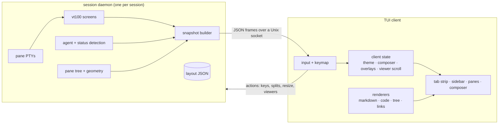

# herdstead

**A terminal workspace manager for coding agents — a homestead for your herd.**

One Rust binary. Panes, tabs and workspaces that survive a detach, plus a
terminal that recognises links, themes, Markdown, `@path` references,
syntax-highlighted files and folder trees.

[](https://github.com/jaysonwu991/herdstead/actions/workflows/ci.yml)
[](LICENSE)
[](Cargo.toml)

[**Documentation**](docs/README.md) · [getting started](docs/getting-started.md) ·
[sessions](docs/sessions.md) · [composer](docs/composer.md) ·
[viewers](docs/viewers.md) · [themes](docs/themes.md) ·
[configuration](docs/configuration.md) · [keys](docs/keys.md) ·
[architecture](docs/architecture.md) · [troubleshooting](docs/troubleshooting.md)
· [brand](docs/brand.md)

---

## Why

[herdr](https://github.com/herdrdev/herdr) established the shape: a runtime your
coding agents live on, with panes you split, tabs you switch and a session you
detach from and reattach to without stopping the work. `herdstead` keeps that
shape and adds what a modern agent terminal needs to stay readable: the kind of
rendering you expect from a desktop chat composer, available inside the
terminal.

| | herdstead |
|---|---|
| panes, tabs, workspaces, detach/attach | yes |
| session restored after a restart | yes (`restore = true`) |
| terminal output | full VT screen per pane, truecolor, scrollback |
| links | URLs and file paths are detected, clickable, and emitted as OSC 8 |
| themes | six built-ins plus JSON themes and per-slot overrides |
| Markdown | composer preview, `/md`, `herdstead md`, and viewer panes |
| `@path` | completion, existence-checked colouring, click to open |
| `cat` | syntax highlighted like an editor (`herdstead cat`) |
| folder trees | `herdstead tree`, `/tree`, and tree viewer panes |

## Build

```bash
cargo install --git https://github.com/jaysonwu991/herdstead.git herdstead
```

That puts `herdstead` in `~/.cargo/bin`. To hack on it instead:

```bash
git clone https://github.com/jaysonwu991/herdstead.git
cd herdstead
cargo build --release          # target/release/herdstead
# or: cargo install --path crates/app
```

Requires a recent Rust toolchain. macOS and Linux (the client and daemon talk
over a Unix socket). `cargo build --release` takes about 15 seconds and produces
a 5 MB binary with no runtime dependencies.

Attaching needs an interactive terminal. Run from a pipe or a script,
`herdstead` refuses before it starts a session and points at the
non-interactive commands instead; those work anywhere.

## Quick start

```bash
herdstead                 # start or attach to a session named after the folder
herdstead -s work         # a named session
```

Then:

- type in the pane like any terminal; `ctrl+b` is the prefix for everything else
- `ctrl+b :` opens the **composer** — a prompt line for the focused agent
- `ctrl+b v` / `ctrl+b s` split the pane side by side / stacked
- `ctrl+b q` detaches; `herdstead` reattaches with the panes still running
- `ctrl+b ?` lists every binding

```
 ┌ tab strip ──────────────────────────────────────────────────────── ctrl+b ┐
 │ ▦ herdstead  1 shell ●  2 tests ○                                         │
 ├──────────────┬────────────────────────────────────────────────────────────┤
 │ herdstead   │ ┌ ✳ claude ● ────────────────────────────────────────────┐  │
 │              │ │ ✓ cargo test — all green                               │  │
 │ WORKSPACES   │ │ see https://herdr.dev/docs and src/main.rs             │  │
 │  ● herdstead│ │ @src/render/markdown.rs                                │  │
 │  ○ oxide     │ └────────────────────────────────────────────────────────┘  │
 │              │ ┌ tree src ───────────────────────────────────────────────┐  │
 │ TABS         │ │ src/            42 files · 6 folders                    │  │
 │    ● shell   │ │ ├─ main.rs                              1.2 KB         │  │
 │    ○ tests   │ │ └─ render/                                              │  │
 │              │ │    └─ markdown.rs                       18.4 KB        │  │
 │ PANES        │ └────────────────────────────────────────────────────────┘  │
 │    ● claude  │                                                            │
 ├──────────────┴────────────────────────────────────────────────────────────┤
 │ ❯ ctrl+b : prompt the agent · @path opens a file or folder · / commands   │
 │ herdstead ~/proj  working claude          midnight · ctrl+b prompt · ?   │
 └───────────────────────────────────────────────────────────────────────────┘
```

## The six features

### 1. Links are recognised

Terminal output is scanned for URLs and file paths on every frame. A URL is
styled in the theme's link colour and underlined; a path only becomes a link
when it exists relative to the pane's working directory, so prose that merely
looks like a path never turns into one.

- **Open one:** hold the link modifier (Cmd on macOS, configurable) and click.
  URLs go to the browser; paths open in a viewer pane — a folder becomes a tree,
  Markdown renders, everything else is highlighted.
- **Without a mouse:** `herdstead cat` emits real OSC 8 hyperlinks, so `cat`'s
  output is clickable in iTerm2, Ghostty, Kitty, WezTerm, VS Code's terminal and
  any other OSC 8 terminal.
- **Hover feedback:** the status bar names the target under the pointer.

More: [panes and output](docs/terminal.md), [viewers](docs/viewers.md).

### 2. Themes

Six built-in palettes, all truecolor:

| theme | appearance | syntax theme |
|---|---|---|
| `midnight` (default) | dark | base16-ocean.dark |
| `daylight` | light | base16-ocean.light |
| `nord` | dark | Nord |
| `gruvbox` | dark | gruvbox-dark |
| `mono` | dark | ansi |
| `solarized` | light | Solarized (light) |

- `ctrl+b t` opens a live-preview theme menu.
- `herdstead --theme nord`, `HERDSTEAD_THEME=nord`, or `theme = "nord"` in the
  config.
- `/theme nord` from the composer.
- Custom themes are JSON files in `~/.config/herdstead/themes/`:

```json
{
  "name": "plum",
  "extends": "nord",
  "colors": { "accent": "#ff00aa", "link": "#7de3ff", "tree_dir": "#ff00aa" }
}
```

- `theme-colors` in the config overrides individual slots without a file.
- The same palette drives the interface, Markdown, syntax highlighting and ANSI
  output, so `herdstead cat` matches what the pane shows.

More: [themes](docs/themes.md).

### 3. Markdown

- **Live preview in the composer.** `ctrl+b m` opens the composer with the
  Markdown preview on; `ctrl+p` toggles it while typing. The preview renders
  headings, lists, task lists, quotes, tables, rules, links and fenced code
  (highlighted with the active theme).
- **As a viewer pane.** `/md README.md` (or clicking a `.md` path) opens a
  rendered Markdown pane beside the agent. Viewers scroll with `j`/`k`, `g`/`G`.
- **In the terminal.** `herdstead md README.md` renders to stdout anywhere;
  `herdstead md --stdin` renders a pipe:

```bash
cat README.md | herdstead md --stdin
```

More: [the composer](docs/composer.md), [viewers](docs/viewers.md).

### 4. `@path` references

The composer completes file and folder references as you type:

- type `@` and the current pane's folder is scanned (build output skipped);
  `↑`/`↓` move, `Tab`/`Enter` accepts
- folders complete with a trailing `/`, paths with spaces are quoted
  automatically
- `@src/lib.rs#L12-L14` keeps the location suffix out of the path
- a reference that does not exist is drawn in the theme's error colour, so a
  typo is visible before you send
- send with `Enter`; the prompt goes to the focused agent pane

`herdstead cat` and the viewers treat the same syntax as a link, so a reference
in the transcript is clickable too.

More: [the composer](docs/composer.md).

### 5. `cat`, highlighted like an editor

```bash
herdstead cat src/render/markdown.rs
herdstead cat Cargo.toml --no-line-numbers
```

- 213 languages via [bat](https://github.com/sharkdp/bat)'s syntax set
  (bundled through `two-face`), including TOML, TypeScript and Dockerfiles that
  syntect's defaults miss
- line numbers, a coloured rail, tabs expanded to four columns
- theme-matched colours, including a monochrome mode
- OSC 8 links for references in the file
- `herdstead languages` lists what is supported

More: [viewers](docs/viewers.md).

### 6. Folder trees

```bash
herdstead tree                    # the current folder
herdstead tree src --depth 3
herdstead tree . --all            # include target/, node_modules/, .git/
```

- folders first, then files, each with a size
- box-drawing guides, colour by kind (folder, file, executable, symlink)
- depth and entry caps so a huge tree cannot stall the renderer
- in a session: `/tree src` or `ctrl+b shift+e` opens a tree pane; clicking a
  folder in a pane opens it as a tree. Viewer panes reuse the same renderer, so
  the CLI and the TUI always agree

More: [viewers](docs/viewers.md).

## Sessions

The daemon owns the panes; the client is a view. Closing the terminal, losing
SSH, or `ctrl+b q` leaves the shells and agents running.

```bash
herdstead ls                  # live sessions and their pane counts
herdstead kill work           # stop a session, keeping its saved layout
herdstead kill work --forget  # stop it and delete the layout
```

- sessions live under `$XDG_RUNTIME_DIR/herdstead/<name>.sock` (or
  `/tmp/herdstead-<uid>/`), one daemon per session
- the layout is saved to `$XDG_STATE_HOME/herdstead/sessions/<name>.json`, so
  with `restore = true` the next start re-creates every pane in its folder
- panes report their folder through OSC 7, which the new-pane and viewer paths
  use as their base
- a daemon's log is at `$XDG_STATE_HOME/herdstead/logs/<name>.log`

More: [sessions](docs/sessions.md).

## Keys

`ctrl+b` is the prefix unless `keybind-prefix` says otherwise.

| key | action |
|---|---|
| `prefix+v` / `prefix+s` | split side by side / stacked |
| `prefix+x` | close the focused pane |
| `prefix+h` `j` `k` `l` | focus left / down / up / right |
| `prefix+o` / `prefix+i` | focus next / previous pane |
| `prefix+z` | zoom the focused pane |
| `prefix+c` / `prefix+w` | new tab / close tab |
| `prefix+n` / `prefix+p` | next / previous tab |
| `prefix+1`…`9` | go to a tab |
| `prefix+shift+n` | new workspace |
| `prefix+[` / `prefix+]` | previous / next workspace |
| `prefix+shift+1`…`9` | go to a workspace |
| `prefix+: ` | open the composer |
| `prefix+t` | theme menu |
| `prefix+m` | Markdown preview |
| `prefix+e` / `prefix+shift+e` | open a file / a folder tree |
| `prefix+|` | show or hide the sidebar |
| `prefix+r` | reload config and theme |
| `prefix+q` | detach |
| `prefix+?` | keybinding help |
| `prefix+pgup` / `pgdn` / `home` / `end` | scroll the pane |
| `super+click` | open the link or path under the pointer |

Mouse: click to focus, drag a divider to resize, scroll to move through
scrollback (or a viewer), click a tab, workspace or pane in the sidebar.

Composer keys: `Enter` sends, `Shift+Enter` inserts a newline, `Tab` accepts a
completion, `Ctrl+P` toggles the preview, `Ctrl+A/E/K/U/W` edit the line, `Esc`
closes. The composer also takes commands:

```
/split [h]      /close        /tab [dir]     /workspace    /select <n>
/theme <name>   /open <path>  /tree [path]   /cat <file>   /md <file>
/rename-tab     /rename-workspace            /scroll-top   /scroll-bottom
/help           /detach
```

Everything under `[keybinds]` can be rebound:

```toml
[keybinds]
split-vertical = "prefix+|"
close-pane = "prefix+shift+q"
```

## Configuration

`herdstead init` writes `~/.config/herdstead/config.toml`; a project can add
`.herdstead/config.toml` (or `herdstead.toml`) which layers over it.
`herdstead config` prints the resolved result.

```toml
theme = "midnight"
shell = "/bin/zsh"
scrollback = 5000
links = true
link-modifier = "super"      # super | ctrl | alt
mouse = true
sidebar = true
sidebar-width = 28
# Open the composer with the Markdown preview already on.
composer-markdown-preview = false
status-bar = true
restore = true
tree-ignores = ["target", "node_modules", ".git", "dist", "build", ".venv"]
tree-max-entries = 4000
keybind-prefix = "ctrl+b"

[keybinds]
[theme-colors]
accent = "#8b5cf6"
```

| environment variable | meaning |
|---|---|
| `HERDSTEAD_SESSION` | default session name |
| `HERDSTEAD_THEME` | theme name |
| `HERDSTEAD_CONFIG_DIR` | config root (themes live in `themes/`) |
| `HERDSTEAD_STATE_DIR` | saved layouts and logs |
| `HERDSTEAD_RUNTIME_DIR` | sockets |

## How it works



The split follows herdr's guidance: **runtime facts** (panes, layout, focus,
scrollback, agent status) live in the daemon, while **presentation** (theme,
composer text, viewer scroll, overlays) never leaves the client. Every frame is
a complete snapshot, which keeps reattaching trivial: a new client draws the
session from the next message.

Crates:

- `crates/core` — layout, session model, protocol, themes, agent detection,
  `@path` parsing, text utilities. No terminal dependency.
- `crates/render` — Markdown, syntax highlighting, trees, link decoration, the
  composer, ANSI output. Pure: text plus a theme in, styled rows out. The TUI and
  the CLI share it, so `herdstead cat` and a viewer pane draw the same thing.
- `crates/app` — the daemon (`server/`), the TUI client (`tui/`) and the CLI.

## Tests

```bash
cargo test --workspace
cargo clippy --workspace --all-targets
```

- unit tests for layout geometry, panes, themes, mention parsing, Markdown,
  highlighting, trees, wrapping and link decoration
- render tests that assert exact columns, links surviving a wrap, table
  alignment, and image placeholders
- `tests/runtime.rs` drives a real daemon: a shell pane, typed keys, splits,
  scrollback, viewer panes, kill, restart and layout restore
- `tests/client.rs` drives the real TUI in a PTY: the drawn chrome, prefix
  splits, the composer, `@path` completion, Markdown preview, viewer panes,
  detach and reattach, resizing, and the non-TTY guard

## Limitations

- macOS and Linux only: the daemon and client talk over a Unix socket.
- Mouse events are used by the interface; they are not forwarded to programs
  inside a pane, so apps that need mouse input (some scrollbars, htop's mouse)
  will not see it.
- One layout per session: the most recently attached client's size wins, so two
  clients of very different sizes will re-layout for each other.
- Viewer panes read files on the client, so a session attached from another
  machine (not supported yet) would need that file locally.
- Scrollback is a fixed number of rows (`scrollback`, default 5000).

## Name and mark

`herdstead` is a coinage: **herd** + **stead** — a homestead for a herd. The
mark is a stead whose window is a pane grid, with one pane lit for the agent
that has focus; the amber is the hearth. Assets live in `assets/`:

| file | use |
|---|---|
| `logo.svg` | horizontal lockup, dark backgrounds |
| `logo-light.svg` | horizontal lockup, light backgrounds |
| `logo-mark.svg` | square mark, app icon and avatar |
| `logo-mark-mono.svg` | single-ink mark, print and one-colour use |

Palette: ink `#10161F`, mist `#D7DCE5`, hearth `#F0A64A` (and `#A6620F` for the
tagline on light backgrounds).

## Credits

Inspired by [herdr](https://github.com/herdrdev/herdr) by herdrdev
(Apache-2.0): the workspace/tab/pane runtime, detach and reattach. `herdstead`
is an independent implementation, not a fork.

Syntax highlighting uses [syntect](https://github.com/trishume/syntect) with
[bat](https://github.com/sharkdp/bat)'s syntax and theme sets via
[two-face](https://codeberg.org/CosmicHarper/two-face). Terminal emulation is
[vt100](https://github.com/doy/vt100-rust); the TUI is
[ratatui](https://ratatui.rs) and [crossterm](https://github.com/crossterm-rs/crossterm).

Licensed under Apache-2.0. See [LICENSE](LICENSE).
