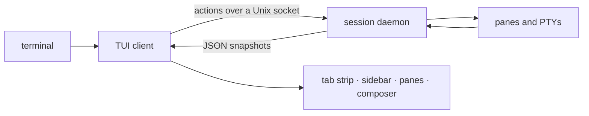

# herdstead docs

herdstead is a terminal workspace manager for coding agents: panes, tabs and
workspaces that keep running when you detach, with a terminal and viewers that
render links, themes, Markdown, `@path` references, highlighted files and folder
trees.

New here? Read [getting started](getting-started.md) first, then the page for
whatever you are trying to do.

| page | what it covers |
|---|---|
| [Desktop](desktop.md) | Tauri app, zsh, native builds, rich terminal features and desktop shortcuts |
| [Getting started](getting-started.md) | install, first session, the layout, the first five minutes |
| [Sessions](sessions.md) | the daemon, detach and reattach, restore, listing and stopping sessions, agent status |
| [Panes, tabs, workspaces](terminal.md) | splits, focus, zoom, scrollback, the mouse, links in output |
| [The composer](composer.md) | prompting an agent, `@path` completion, Markdown preview, slash commands |
| [Viewers](viewers.md) | highlighted files, rendered Markdown, folder trees |
| [Themes](themes.md) | built-in palettes, theme files, colour slots, the syntax theme |
| [Configuration](configuration.md) | every setting, file layering, environment variables |
| [Keys](keys.md) | the complete keymap, the mouse, rebinding |
| [Architecture](architecture.md) | crates, the runtime/client boundary, the wire protocol, persistence |
| [Troubleshooting](troubleshooting.md) | logs, stale sessions, config warnings, restore problems |
| [Brand](brand.md) | the name, the mark, the palette, using the assets |

These pages describe the implementation in this checkout. Release binaries may
differ; use `herdstead --version` to identify your build.

## The shape of it

One binary, two roles: `herdstead` attaches to a session (starting its daemon if
one is not running), and `herdstead --server` is that daemon. The daemon owns the
processes, the layout, focus and terminal scrollback offsets; the client owns
the theme, the composer and viewer scroll positions. That split is why closing the terminal leaves your agents
working, and why reattaching is instant.

## The features in one page

- **Links** — URLs and existing paths in pane output are recognised, underlined,
  and open with a modifier-click. The CLI emits OSC 8 hyperlinks too.
- **Themes** — six built-in palettes, JSON themes, per-slot overrides, and one
  palette across the interface, Markdown, highlighting and ANSI output.
- **Markdown** — a composer preview, viewer panes, `herdstead md`, and the
  renderer behind this documentation.
- **`@path`** — completion in the composer, existence-checked colouring,
  `#L12-L14` locations, click to open.
- **`cat`** — editor-style highlighting for 213 languages.
- **Trees** — a folder renderer in the CLI and as a viewer pane.

Ready? [Getting started](getting-started.md).
