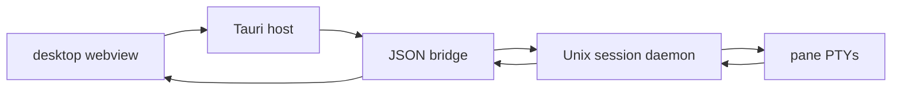
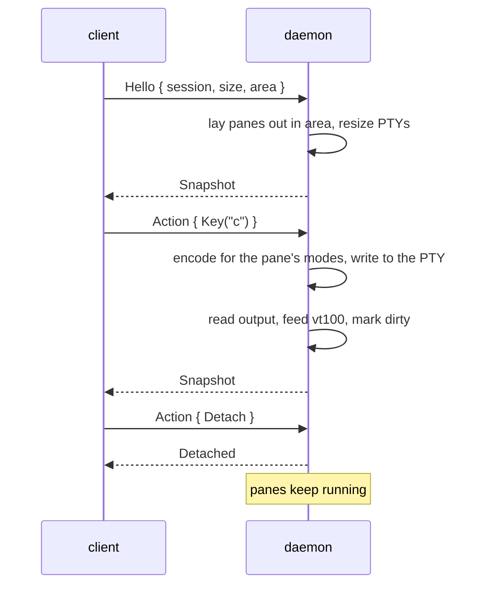

# Architecture

Herdstead is a Tauri desktop app with a bundled Rust runtime. The native host
starts a JSON bridge; the bridge connects to a persistent session daemon over a
Unix socket. The daemon owns panes, processes, layout, focus and scrollback.
The webview owns presentation. There is no standalone interactive TUI.



**Runtime facts** — panes, their trees, split ratios, focus, scrollback offsets,
working folders, agent status — live in the daemon. **Presentation** — theme,
input decoration, overlays, viewer scroll, the pointer — never
leaves the client. This mirrors the guidance herdr sets out, and it keeps the
protocol small: an action either changes the session or it does not exist.

## Crates

| crate | responsibility | dependencies |
|---|---|---|
| `herdstead-core` | geometry, pane tree, session model, protocol types, themes, config, agent detection, `@path` parsing, text and link scanning | serde, toml |
| `herdstead-render` | Markdown, syntax highlighting, trees, link decoration, the composer, ANSI output | syntect, two-face |
| `herdstead` (bundled binary) | daemon, desktop bridge, shell helpers | crossterm, portable-pty, vt100, the two crates above |

Drawing functions are pure: text plus a `Theme` in, styled rows out.
`code::highlight_file`, `render_file`, `render_path` and `tree::scan` perform file
IO; clients choose when to invoke them.
The desktop maps those rows into webview spans; shell helpers map them into ANSI. That
is why files, Markdown pages and trees share rendering behaviour in panes and
`herdstead cat`/`md`/`tree`.

### Modules

| module | contents |
|---|---|
| `core::geom` | `Rect`, `Dir`, `Axis` |
| `core::layout` | `Node` (leaf/split), `split_areas`, `neighbor`, `resize`, `swap` |
| `core::model` | `SessionState`, `Workspace`, `Tab`, `PaneMeta`, `CloseOutcome` |
| `core::protocol` | frames, `Request`, `Event`, `Action`, `Snapshot`, `GridFrame` |
| `core::theme` | `Rgb`, `xterm256`, `Theme`, slots, built-ins, theme files |
| `core::config` | `Config`, layering, `ACTIONS`, binding parser |
| `core::detect` | `AgentKind`, `PaneStatus`, classification heuristics |
| `core::mention` | `@path` token, ranges, suggestions |
| `core::text` | URL and path scanners, widths, wrapping helpers |
| `render::style` | `Style`, `Span`, `Line`, `Link` |
| `render::wrap` | cell-based wrapping that preserves styles and links |
| `render::inline` | inline Markdown, links, mentions, images |
| `render::markdown` | block renderer |
| `render::code` | syntect highlighting, gutters, truncation |
| `render::tree` | directory scan and tree drawing |
| `render::link` | link decoration with existence checks |
| `render::term` | terminal runs → styled rows |
| `render::composer`, `render::ansi` | composer decoration/layout; ANSI output |
| `server` | runtime, PTY panes, grid extraction, key encoding |
| `desktop`, `viewer` | bridge, client rendering and viewer IO |

## The protocol

Frames are newline-delimited JSON over a Unix socket. Socket readers currently
read whole lines without enforcing a frame-size limit; the desktop bridge
separately caps incoming messages at 32 MiB. A client says:

| request | meaning |
|---|---|
| `Hello { session, size, area }` | attach, and tell the runtime where panes may go |
| `Action { action }` | an intent (below) |
| `Inspect { session }` | read the state without attaching (`herdstead ls`) |
| `Refresh` | ask for a snapshot |
| `Kill` | stop the session |

The daemon answers with `Snapshot { snapshot }`, `Detached { reason }` or
`Error { message }`.

`Action` covers input and structure:

| family | variants |
|---|---|
| input | `Key { input }`, `Paste { text }`, `SendText { text, submit }` |
| panes | `Split { dir }`, `ClosePane`, `KillPane { pane }`, `FocusPane`, `FocusDir`, `FocusCycle`, `ToggleZoom`, `ResizePane { dir, cells }` |
| scrolling | `ScrollPane { pane, delta, page }`, `ScrollToTop`, `ScrollToBottom` |
| tabs | `NewTab { cwd }`, `SelectTab`, `CycleTab`, `CloseTab`, `RenameTab` |
| workspaces | `NewWorkspace { dir }`, `SelectWorkspace`, `CycleWorkspace`, `CloseWorkspace`, `RenameWorkspace` |
| viewers | `OpenViewer { path, kind, split }` |
| naming | `RenamePane { name }` (tabs and workspaces have their own rename actions) |
| session | `Resize { size, area }`, `Detach`, `Kill` |

Keys are sent as semantic events, not bytes. The runtime encodes them for the
pane's current modes: application cursor keys become `SS3` sequences, modified
arrows become `CSI 1;mX`, `Delete`/`PageUp`/`F1`–`F12` follow xterm, and a paste
is wrapped in `200~`/`201~` when the program enabled bracketed paste. The client
never has to guess what a pane expects.

### A snapshot

A snapshot is the whole picture, not a diff:

| field | contents |
|---|---|
| `session`, `version`, `seq` | identity and a counter bumped by every structural change |
| `size`, `area` | the terminal size and the rect the client reserved for panes |
| `workspaces` | one entry per workspace: name, folder, status, pane count, agent, tabs, active tab |
| `active_workspace`, `focused`, `zoomed` | the selection |
| `panes` | one `PaneFrame` per pane in the active tab |

A `PaneFrame` carries its `rect`, title, working folder, command, kind (shell or
viewer), viewer spec, agent, status, bell, exit code, scroll offset and — for
shells — a `GridFrame`.

A `GridFrame` is the visible screen: `rows` × `cols` of `StyledLine`s, each a run
list of `(text, TermStyle)`, plus `wrapped` flags, the cursor, the scrollback
offset, how many scrollback rows exist, and whether the alternate screen is
active. Runs are merged per cell style and trailing blanks without a background
are dropped, which keeps a busy frame in the tens of kilobytes rather than the
hundreds.

Snapshots are produced on demand (attach, `Inspect`) and broadcast after any
change, at most once per runtime loop iteration. The 50 ms receive timeout is
an idle wait, not a broadcast rate limit. Each client has a two-frame queue: when it is
full, newly offered frames are dropped while queued frames remain. A later
successful snapshot is complete, so no diff replay is needed.

## The daemon



Threads in one daemon:

| thread | job |
|---|---|
| main | receive messages, apply actions, tick, broadcast, save |
| accept | one listener thread accepting incoming connections |
| client reader | frames in, per client |
| client writer | pre-encoded frames out, per client |
| pane reader | blocking reads from the PTY, OSC tracking, feed the runtime |
| pane waiter | reap the child and report its exit code |

The main loop waits up to 50 ms for a message, handles everything queued, and
then: re-classifies panes every 250 ms, broadcasts if anything changed, and
saves changed session state when at least two seconds have passed since the
previous save. It does not wait for a quiet period after the last change.
Signals are handled with a flag: `SIGTERM`/`SIGINT` save and stop, `SIGHUP` and `SIGPIPE`
are ignored.

A pane is a real PTY (`portable-pty`) with a `vt100::Parser` sized to the pane's
inner rect and a scrollback capacity from the config. Its reader thread also runs
a small OSC tracker over the last 4 KiB of output to pick up the window title
(OSC 0/2) and the working folder (OSC 7, percent-decoded). The grid is read cell
by cell (wide continuations skipped, wide characters kept once, runs merged) and
clipped to the pane rect.

Agent detection runs on a tick, not per byte. The PTY's foreground process group
identifies the current job; its command is queried when the group changes.
Returning control to the shell clears the agent, even if an old banner or title
remains visible. Generated pane labels never feed back into detection. Status
uses the pane's text tail (40 lines), quiet time and process exit state.

### Layout

A tab's layout is a binary tree of leaves and splits:

```
Node::Split { dir: Vertical, ratio: 0.5,
    first:  Leaf(p1),
    second: Split { dir: Horizontal, ratio: 0.5,
        first:  Leaf(p2),
        second: Leaf(p3) } }
```

- `split_areas` reserves one divider cell and at least one cell per child when
  the split axis has three or more cells. Smaller areas omit the divider and
  may leave a child with zero cells.
- Ratios are clamped to `0.05..=0.95` during layout and resizing.
- `resize(pane, dir, cells)` finds the nearest ancestor split whose axis matches
  and whose side the pane is on, and moves that divider.
- `neighbor(placements, pane, dir)` picks the closest pane in that direction,
  preferring one that overlaps the current pane on the perpendicular axis — which
  is what makes `h/j/k/l` feel like it follows the screen.
- A zoomed tab returns the focused pane filling the whole area.
- Each shell PTY is sized to its pane's **inner** rect (the frame is one cell).

The runtime lays out only the active tab. Switching tabs, zooming, resizing or
closing anything re-runs the layout and resizes the PTYs that are visible.

### Restoring

`SessionState` serialises whole: workspaces, tabs, the layout tree, ratios, focus,
zoom, pane metadata and the id allocator. On start the daemon reads it, drops
panes that no longer belong to a tab, and re-detects status. A restored shell
starts a fresh process in its recorded folder when its tab first becomes visible.
Running processes and their output are not restored.

## The client

`crates/desktop/ui` renders snapshots, translates keys and paste into semantic actions,
and measures the terminal font to send cell geometry to the daemon. It indexes
bounded directory replies for project file search; opening a result sends the
existing `open_viewer` action. Viewer scroll, appearance, rich-output preference
and file panel state stay local.
`crates/app/src/viewer.rs` loads viewer files and uses the shared renderers.
The bundled runtime also provides ANSI shell commands from those same renderers.

## Testing

| layer | what it proves |
|---|---|
| unit tests in `core` | geometry, splits, closing, focus, resize, themes, config layering, binding syntax, mention parsing, link scanning |
| unit tests in `render` | exact columns, links surviving wrapping, table alignment, image placeholders, code gutters, tree scanning, ANSI output |
| `crates/app/tests/runtime.rs` | a real daemon: shell output, typed keys, splits, scrollback, viewer panes, kill, restart-restore, error frames |
| `crates/desktop/tests` | real daemon bridge, zsh integration, terminal rendering, file search and browser E2E |
| `scripts/test_desktop_release.py` | installer completeness, signed manifest assembly, checksums and version stamping |

The end-to-end tests spawn the built binary and talk to it the way a user does,
which is why a regression in the socket protocol or in key encoding fails a test
rather than surfacing as a silent mis-render.

## Desktop client

`crates/desktop/native` is the Tauri 2 application, a member of the root Cargo
workspace. It embeds the static client from `crates/desktop/ui` in the
system webview and bundles the ordinary `herdstead` binary as a resource. The
native host starts `herdstead desktop-bridge` with piped stdin/stdout. That process
uses `client::connect_or_spawn` and the existing Unix socket protocol; the daemon
has no knowledge of desktop presentation. No `Action` or `Snapshot` fields change.

The bridge uses newline-delimited JSON with a 32 MiB incoming message cap.
Runtime snapshots retain their protocol shape, alongside `screens` containing
styled spans from `render::term` and `render::link`. The pane's cursor cell is
the run carrying `cursor: true`, padded back to its column when the renderer
trimmed a prompt row short, so the client draws a block on a cell instead of
guessing where the text ended up. Desktop requests have a
numeric `id` and a `type`: `action` forwards a typed daemon action; `directory`
returns a bounded shallow listing; `viewer` invokes the existing client viewer;
`preview` renders Markdown; `theme` changes the bridge's client-local
palette; `rich_output` switches client-side output interpretation. Replies echo the id and carry either `value` or `error`. Theme changes
refresh snapshots without changing the daemon's settings.
The bridge's `ready` event also supplies the client's home directory as `home`.
The desktop abbreviates home paths and automatic home workspace labels to `~`,
preserving absolute runtime paths and custom workspace names.
On stdin EOF or an input error, the bridge shuts down its socket and joins the
event reader before exiting, so a snapshot already being written reaches stdout
as a complete JSON frame. The independent session daemon remains running.

The Tauri host exposes only these operations, reconnect, cached initial state,
a native folder picker and allowlisted HTTP/HTTPS/mailto opening. Pending requests
are capped at 128 and time out after 15 seconds. A connection generation prevents
late events from a stopped bridge affecting a reconnected window. Closing the
app stops its bridge; the independent daemon keeps the PTYs alive.

The bridge drains daemon events independently of rendering. Consecutive pending
snapshots replace one another, and rendering starts at most once every 16.7 ms;
the final pending snapshot is delivered even when output stops. Control events
retain their order. This bounds obsolete rendering work during output bursts
without delaying input forwarding or changing the daemon protocol.

The page measures the terminal font and translates available pixels into a cell
area. The daemon remains authoritative for layout, focus and PTY sizes. Semantic
keys, input-method text and bracketed paste use semantic runtime actions.
Themes, rich-output preference, viewer scroll, panel visibility and fonts remain
client-side. Terminal rows are updated only when their spans change, structural
chrome and resize handles are keyed separately, wheel events are combined per
animation frame, resize events are debounced, and viewer reads are cached for a
second. Row signatures stay in client memory rather than DOM attributes. Files
and Markdown never become executable HTML.
The native application menu emits fixed `herdstead:command` events for Settings
and update checking. The client opens the same Settings dialog used by the
sidebar and Cmd/Ctrl+comma. An update check reports availability; installation
still requires the explicit install button.

### Shell integration and output interpretation

Desktop-started daemons receive `HERDSTEAD_SHELL_HELPERS=1`. For zsh panes,
`server::pane` prepares startup wrappers under the private runtime directory,
sources the original startup files once and loads `shell/herdstead.zsh` after the
user's zshrc. It restores the user's ZDOTDIR before their framework runs. No user
file is edited. The addon only supplies output helpers and OSC 7 working-folder
updates; line editing, completion and `@path` text remain native to zsh. The
daemon still owns only the PTY and runtime facts; no command-line buffer or
presentation field enters the protocol.

`render::term::rich_lines` is pure and used by the desktop bridge. It interprets
plain Markdown output a row at a time and highlights fenced code with the shared
syntax engine. It preserves row count and leaves the cursor row, soft-wrapped
content, already styled output and alternate-screen applications out of block
interpretation. The editable logical line is never parsed as Markdown.
The desktop can select raw output instead. Complete Markdown documents use the shared block renderer
through `md`/`render`, so tables and paragraph reflow are not constrained to a
terminal screen's existing rows.

`term::decorate_output_links` skips the editable logical line, including its soft
wraps, so input keeps the terminal's characters and styles. Output links are
scanned across style runs so a URL interrupted by ANSI colour changes still
carries one complete target. The desktop serialises badge offsets into existing
blank cells or the gutter; local SVG logos are presentation only and add no text
or PTY columns.

## Desktop distribution and updates

The release workflow builds the runtime and Tauri host for macOS arm64/x64 and
Linux arm64/x64. `CARGO_BUILD_TARGET` keeps the bundled runtime on the same target
as the app. Version stamping covers the workspace Cargo manifest, the desktop package manifest and Tauri
configuration. Native installers are DMGs, AppImages and Debian packages.
`scripts/desktop-release.py` stages stable platform names and refuses to publish
until every installer and updater signature exists. It assembles `latest.json`
with darwin/linux architecture keys and publishes `SHA256SUMS`.

The native host registers Tauri's updater plugin. `check_update` caches the
candidate update; `install_update` consumes it, downloads and verifies its
signature, installs it, stops the bridge and restarts the app. On macOS, a
detached helper waits for the old process to exit before asking LaunchServices
to open the updated bundle without forcing a second instance; this keeps the
replaced bundle to one Dock icon. Daemons remain running. The page only exposes
explicit check/install buttons and status text.
The public updater key is committed in Tauri config; its private half is a
GitHub Actions secret. No protocol fields are added for updater presentation.
Apple code signing/notarisation is separate from updater signatures.
